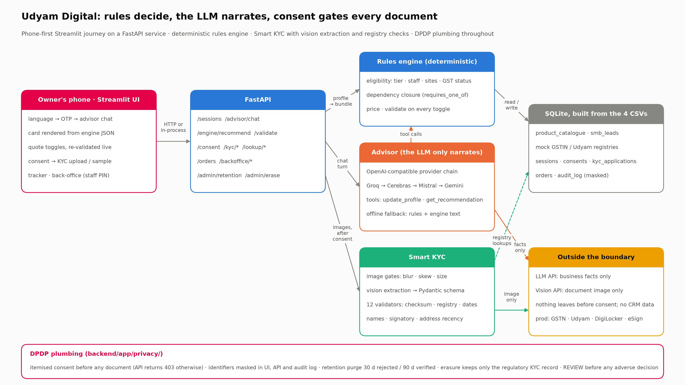

# Udyam Digital — Accel Business SMB onboarding (YTL Hackathon 2026, Track A)

[](https://github.com/Sheel23501/udyam-digital/actions/workflows/ci.yml)

A phone-first, Hindi/English journey that lets a small business owner discover the right Accel Business bundle, get a single-price quote, complete Smart KYC against mock GSTIN/Udyam registries, and track activation — with no salesperson in the loop.

**Stack:** Python 3.13 · FastAPI · SQLite · Streamlit · advisor LLM on Groq `openai/gpt-oss-120b` through an OpenAI-compatible provider chain (Cerebras → Mistral → OpenRouter → Gemini as fallbacks) · KYC vision on Gemini (`google-genai`). Runs entirely on free tiers.

**Checking it yourself:** [step-by-step guide](docs/how-to-check.md): clone → install → one-shot checks → every API endpoint by hand with expected output.

**Docs:** [architecture](docs/architecture.md) · [privacy & security note (DPDP)](docs/privacy-note.md) · [deploy](docs/deploy.md) · [demo script & live-scenario playbook](docs/demo-script.md) · [demo transcripts](docs/demo-transcripts.md) · [charts and the numbers behind them](docs/charts/README.md)

**Design rule:** the rules engine (`backend/app/engine/`) decides what may be sold; the LLM only asks questions and narrates the engine's result. Every bundle is re-validated before it is shown.

## Run locally

```bash
cp .env.example .env            # add GROQ_API_KEY (advisor) and GEMINI_API_KEY (KYC vision); CEREBRAS_API_KEY optional
/opt/homebrew/bin/python3.13 -m venv .venv && source .venv/bin/activate
pip install -r backend/requirements.txt -r frontend/requirements.txt
./run_local.sh                  # backend :8000, UI :8501
```

Free keys: Groq at console.groq.com, Cerebras at cloud.cerebras.ai, Gemini at aistudio.google.com/apikey. No card needed for any of them.

## The app (Streamlit, phone-shaped)

`./run_local.sh` starts the API on :8000 and the UI on :8501. Or run only `streamlit run frontend/app.py`: when no backend
answers, the UI imports the backend package and calls it in-process (`API_MODE=auto`), so one process is enough.

Journey: language → mobile number + one-time code (a fresh random 6-digit code per request, see below) → advisor chat (Hindi / English / Hinglish, example chips) → recommendation card
drawn from engine JSON → quote with toggles and quantities, every change re-validated → DPDP consent with itemised purposes → Smart KYC
(upload four photos, or pick sample applicant K01–K12) → order → tracker with dated stages, demo "advance" and consent withdrawal.
Back-office page (sidebar, staff PIN from `STAFF_PIN`; no default): scored queue of unclosed leads, lead detail with reasons, audit log, retention purge, erasure.

Headless UI tests drive the whole journey with Streamlit's `AppTest` and no server: `pytest frontend/tests -q` from the repo root.

## Deploy (all free, no card)

Click-by-click steps, the phone smoke test and troubleshooting are in [docs/deploy.md](docs/deploy.md).

**Option A — one process on Streamlit Community Cloud (recommended):** New app → this repo → main file `frontend/app.py` →
Advanced settings: Python 3.13, secrets:

```toml
API_MODE = "inprocess"          # the UI serves the API in the same process
GROQ_API_KEY = "..."
GEMINI_API_KEY = "..."
TODAY = "2026-07-15"
STAFF_PIN = "<choose a PIN>"
```

The root `requirements.txt` and `packages.txt` are for this deployment. No other service is needed.

**Option B — two services:** API on Render via `render.yaml` (Blueprint, Docker, root `backend/`, set the two keys when asked),
UI on Streamlit Community Cloud with secrets `API_MODE = "http"` and `BACKEND_URL = "https://<your-render-url>"`.

**Docker (judges / any VM):** `cp .env.example .env`, add keys (optional), then `docker compose up --build` → API :8000, UI :8501.
Every push is verified by GitHub Actions (`.github/workflows/ci.yml`): both images are built, `docker compose up --wait` brings them
up healthy, and `scripts/docker_smoke.sh` checks health, the engine checkpoint, the consent gate (403), sample KYC K03 PASS / K11 FAIL,
an advisor reply, and the UI reaching the API over the compose network. Run the same smoke test locally after `docker compose up -d`.

## For judges

All commands run from `backend/` with the virtualenv active.

- **Advisor scenarios as profiles** (rules engine only, instant): `python scripts/run_scenarios.py path/to/folder/` — 30 shipped in `tests/scenarios/`.
- **Advisor scenarios as transcripts** (live LLM + engine): `python scripts/run_llm_scenarios.py path/to/folder/` — 16 shipped in `tests/llm_scenarios/`. Each turn is typed to the advisor; the check is on the engine result and on `validate()` (zero rule violations), never on the prose. Add `--runs 3` to check flakiness, `--save docs/demo-transcripts.md` to write transcripts.
- **KYC report** on the 12 sample applicants: `python scripts/kyc_report.py --key tests/kyc_answer_key_images.json` (cached extractions ship in `data/cache/extractions/`, so this needs no API key).
- **Tests:** `pytest -q` — rules, dependency closure, a 900-profile invariant grid, KYC validators, image gates, and the advisor tool loop with a fake provider (no network).

Scenario JSON formats are documented at the top of each script.

## Mobile verification (OTP)

`POST /auth/otp/request {phone}` generates a fresh random 6-digit code for every request (never a fixed code), stores only
an HMAC of it, and sends it through `SMS_PROVIDER`. `POST /auth/otp/verify {request_id, code}` checks it (5-minute expiry,
single use, locked after 5 wrong tries) and returns a single-use token that `POST /sessions {otp_token}` turns into a
phone-verified session; the number itself is stored only as an HMAC and a masked form. Resend cooldown (30 s) and hourly
caps per number and per client stop SMS-bombing. With no SMS gateway configured (`SMS_PROVIDER=demo`, the default) nothing
is texted: the API returns the code and the app shows it as a clearly labelled demo SMS. Real SMS: `SMS_PROVIDER=messagecentral`
(Message Central VerifyNow: no card, no DLT registration of our own, free test credits) or `SMS_PROVIDER=2factor`; both
generate and check the code on their side, behind the same rate limits. Setup steps: [docs/deploy.md](docs/deploy.md#real-sms-otp). `REQUIRE_OTP=1` makes
verification mandatory for API clients too (the UI always verifies).

## Advisor on free tiers

The deployed demo runs the advisor on paid Gemini (`gemini-3.5-flash-lite`, about 22k tokens or roughly ₹0.65 a conversation) with free Groq as the backup: `ADVISOR_PROVIDER_CHAIN=gemini,groq`. All 16 transcript scenarios pass live on it. Gemini 3 models sign their tool calls; `llm/providers.py: adapt_messages` sends the signatures back (and a documented placeholder for server-injected calls), which those models require.

On free tiers only: Groq allows 8,000 tokens a minute and **200,000 tokens a day** on `gpt-oss-120b`. One conversation is 5–8 model calls of ~2k tokens (about 10–18k tokens), so a single key covers roughly 15 conversations a day; the provider chain (`ADVISOR_PROVIDER_CHAIN`) moves to Cerebras, Mistral, OpenRouter or Gemini when Groq is busy, skipping any provider without a key.

**Three layers keep the recommendation correct whatever the LLM does:**
1. The model never picks products. It records facts with `update_profile`; the rules engine returns the bundle, and the model only narrates it. Explicit product asks in the owner's words ("1 Gbps fibre", "toll-free") are recorded by the server even if the model forgets.
2. Once the five facts are known and the owner has said what they want solved, the server runs the quote itself if the model keeps asking questions.
3. If every provider is down, `app/advisor/chat.py` reads the facts from the owner's words with rules (`language.read_facts`), asks the next question, and explains the engine result in Hindi or English. All 16 transcript scenarios pass in this mode (`ADVISOR_OFFLINE=1 python scripts/run_llm_scenarios.py --allow-offline`, also a pytest). The cached reply for an exact transcript (`data/cache/advisor/`) is used first when present.

Live transcripts recorded on Groq are in `docs/demo-transcripts.md`.

## API (what the UI calls, open to judges)

Start it with `cd backend && uvicorn app.main:app --reload --port 8000`; interactive docs at `http://localhost:8000/docs`.

| Step | Call | Notes |
|---|---|---|
| Start | `POST /sessions {language, partner_code?}` | returns `session_id` |
| Advisor | `POST /advisor/chat {session_id, text}` | reply + `profile` + `recommendation` (engine JSON the card is drawn from) |
| Quote edits | `POST /engine/validate {profile, items}` | violations with reasons, price, what else is addable |
| Engine only | `POST /engine/recommend` (Profile) · `GET /catalogue` | deterministic, no LLM |
| Consent | `GET /consent/notice?lang=hi` · `POST /consent {session_id, purposes, language}` · `DELETE /consent/{id}` | all four required purposes must be ticked |
| KYC | `POST /kyc/upload` (multipart: `session_id`, `doc_type`, `file`) · `POST /kyc/run {session_id, sample_applicant?}` · `GET /kyc/{application_id}` | **403 without consent.** `sample_applicant: "K01".."K12"` uses the provided packs from cached extractions |
| Registry | `GET /lookup/gstin/{gstin}` · `GET /lookup/udyam/{number}` | masked output, 30 req/min, audited |
| Order | `POST /orders {session_id, items?}` · `GET /orders/{id}` · `POST /orders/{id}/advance` | needs a PASS KYC on the session; ETA per stage |
| Back-office | `GET /backoffice/leads` · `GET /backoffice/leads/{id}/score` · `POST /backoffice/handoff` · `GET /backoffice/audit` | live unclosed sessions + 200 scored historical drops |
| Privacy admin | `POST /admin/retention/run` · `POST /admin/erase/{session_id}` | retention purge; DPDP erasure request |

Privacy plumbing lives in `backend/app/privacy/`: `consent.py` (itemised purposes, withdrawal), `masking.py`, `audit.py` (masked subjects only), `retention.py` (30 days rejected / 90 days verified, erasure).

## Architecture



Full description, Mermaid source, repository map and the mocked-vs-real table: [docs/architecture.md](docs/architecture.md).

## What is mocked vs real

| Component | In this prototype | Production |
|---|---|---|
| GSTIN / Udyam registries | CSV-backed mocks (3,534 / 2,723 rows); GSTIN format and check-digit validation are real | GSTN/GSP API, Udyam API |
| Document reading | Gemini vision with a Pydantic schema; sha256 cache so the 12 sample packs need no quota | same, plus DigiLocker pull |
| OTP | real OTP service (random code, hashed, 5-min expiry, 5 tries, resend cooldown, hourly caps); delivery = on-screen demo SMS unless `SMS_PROVIDER` is set | SMS gateway on a DLT-registered template |
| e-sign, payment, notifications | not in scope; toggle only | eSign, payment gateway, WhatsApp/SMS |
| Serviceability | city tier from the leads file | real-time feasibility API |
| Back-office scoring | logistic regression trained on the leads file (holdout AUC 0.68), blended with drop-reason recoverability | retrained on live outcomes |

## Known limitations

- Free-tier LLM quotas (Groq: 200k tokens/day) mean the advisor's prose can fall back to the rules-engine text during heavy use; the quote is unaffected.
- Hindi, English and Hinglish are first-class; other Indian languages get an English reply with an offer of Hindi/English.
- The skew gate catches rotated scans (≥ 2°) but not perspective distortion from a hand-held photo taken at an angle.
- The one-process Streamlit Cloud deployment is the one used for the live demo; the Docker path is verified in CI on every push rather than on a long-running host.
- Partner assignment in the back-office is a UI stub; sessions do record the partner code and referrer.

## Data notes used in the pitch

All computed by `backend/scripts/make_charts.py` from the leads file (see `docs/charts/numbers.json`): 4,632 of 5,000 leads dropped and 48.5% of those drops were the sales process itself; micro retail via field sales cost ₹53,026 per activation for ₹2,619/month; referrals activate at 14.8% vs 7.3% for field sales; GST-registered leads activate at 9.6% vs 2.0%; median lead-to-activation 17 days; customers who had to call 5+ times churned at 28% vs 6% for one call; Hindi + English cover 66% of leads.
