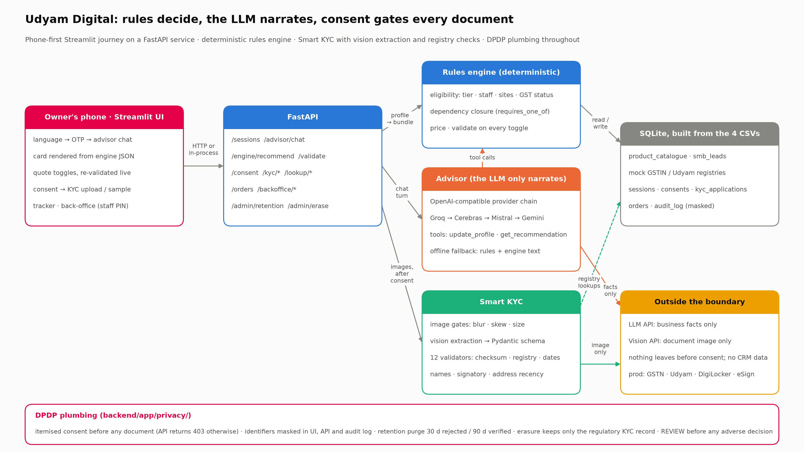
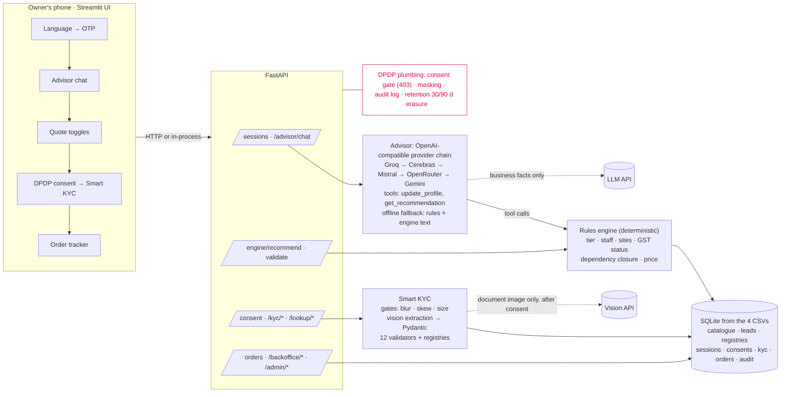

# Architecture



Regenerate the image with `python scripts/make_architecture.py` from `backend/`. The same structure as Mermaid (renders on GitHub):



## Design rules

1. **Rules decide, the LLM narrates.** `engine/rules.py` is the only place that decides what may be sold; `advisor/` collects facts
   and explains the engine's result; the UI renders the card from engine JSON. Explicit product asks and the quote itself are
   enforced server-side even if the model forgets. With no LLM reachable the journey still completes (rule-based intake + engine text).
2. **Consent before documents.** `/kyc/upload` and `/kyc/run` return 403 until a consent covering the four required purposes is
   recorded for the session; withdrawal is one call.
3. **Masked everywhere.** GSTIN `27XXXXXXXXXX1ZP`, Udyam, names; audit log stores masked subjects only.
4. **Deterministic tests over demos.** 1,980+ tests, 30 profile scenarios, 16 transcript scenarios, 12-applicant KYC answer key.

## What is mocked vs real

| Component | Prototype | Production adapter |
|---|---|---|
| GSTIN / Udyam registries | CSV-backed mock (3,534 / 2,723 rows), format + checksum real | GSTN/GSP API, Udyam API |
| OTP | demo code 1234 | SMS OTP provider |
| Document extraction | Gemini vision with Pydantic schema, sha256 cache | same, plus DigiLocker pull where available |
| e-sign / payment | not in scope | eSign (Aadhaar/DSC), payment gateway |
| Serviceability | tier table from leads | real-time feasibility API |
| Notifications | toggle only | WhatsApp Business / SMS |

## Repository map

```
backend/app/engine      catalogue.py rules.py bundles.py models.py        rules + pricing
backend/app/advisor     prompts.py tools.py chat.py language.py explain.py cache.py sessions.py state.py
backend/app/llm         providers.py                                     OpenAI-compatible chain
backend/app/kyc         gates.py extract.py normalise.py checksum.py validators.py pipeline.py images.py report.py schemas.py
backend/app/privacy     consent.py masking.py audit.py retention.py
backend/app/orders      tracker.py service.py
backend/app/backoffice  leads.py propensity.py
backend/app/routers     advisor engine consent kyc lookup orders backoffice
backend/scripts         run_scenarios.py run_llm_scenarios.py kyc_report.py record_demo.py train_propensity.py make_charts.py make_architecture.py
frontend                app.py api_client.py ui/ pages/backoffice.py tests/
docs                    deploy.md demo-transcripts.md charts/ privacy-note.md demo-script.md architecture.md
```
